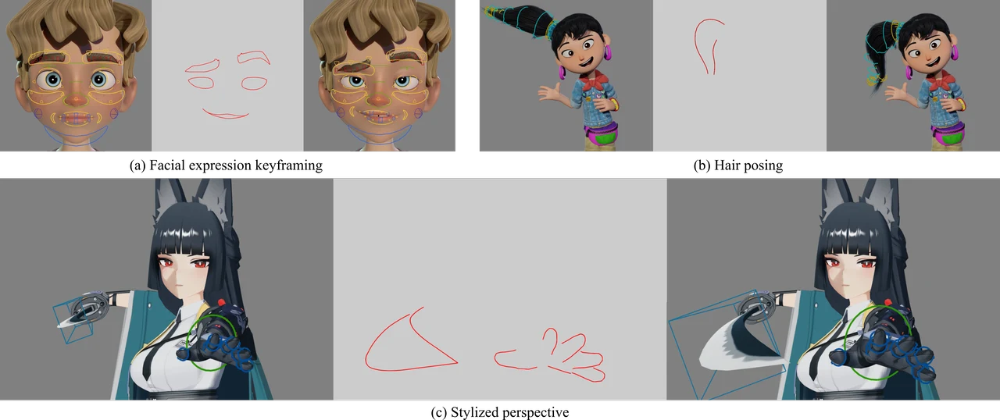

# Inverse Rig Optimization from Line Drawings

**Zihao Zhu, [Yuki Koyama](https://koyama.xyz/)** · The University of Tokyo
Pacific Graphics 2026 (Conference Papers)

[Project page](https://zihaozhu15.github.io/iro-pg26/) ·
[Paper](https://doi.org/10.2312/pg.20261011) ·
[arXiv](https://arxiv.org/abs/2609.00732)



This repository hosts the source of the project page only; it does not contain
an implementation of the method.

## Citation

```bibtex
@inproceedings{10.2312:pg.20261011,
booktitle = {Pacific Graphics 2026 - Conference Papers and Posters},
editor = {He, Ying and Thuerey, Nils and Liu, Lingjie},
title = {{Inverse Rig Optimization from Line Drawings}},
author = {Zhu, Zihao and Koyama, Yuki},
year = {2026},
publisher = {The Eurographics Association},
ISBN = {978-3-03868-327-8},
DOI = {10.2312/pg.20261011}
}
```

## Repository layout

- `docs/`: the static project page served by GitHub Pages.
- `videos/`: source videos for the interactive results.
- `scripts/`: regenerate the web-sized figures and result videos
  (`prepare-images.py`, `prepare-results.py`; see `scripts/RESULTS.md`).

## Credits

Character models © Blender Studio, miHoYo, and DillonGoo Studios. They are
shown for research demonstration only and are not covered by any license of
this repository.
